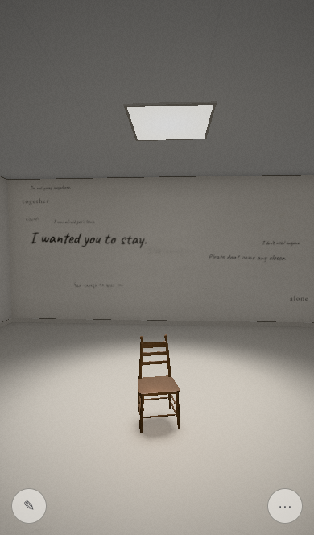

# Pacing: how the room recognises attention, and what changed

The artist tested on a phone and spent too long standing around waiting. The room took up to a minute (or, for someone exploring, two) to answer anything, phases opened on fixed timers (40/95, 140/290, 320/520 s), and taps on writing did nothing at all.

## Since the cinematic opening (October 2026)

The first 20–25 s are now an authored score, not the Director:
- the tap on the black threshold;
- the title;
- a sound in the dark and a switch;
- the chair lit alone;
- the room coming up nearly empty;
- "I wanted you to", written and left unfinished;
- laughter, with its words written as heard;
- the hand-off.

It is described in the README; the reasoning is in `docs/reviews/2026-10-cinematic-opening.md`. The Director is held during the opening (no rule runs and no time passes for it) and starts at the hand-off, so nothing piles up. The persona harness (`tests/playtest/measure.ts`) now starts every visit at the hand-off, with what the opening left. Gaze rests only on writing that exists: in a nearly empty room a persona can't read a line that hasn't been written.

After the hand-off (engine time, median of 8 seeds; `npx vite-node scripts/playtest.ts`):

| Persona | First thing perceptible | Recorded voices by 90 s (plus the opening's) | Longest perceptible gap, first 90 s | Contradiction / transformation |
|---|---|---|---|---|
| Hardly moves | 2.6 s | 3 | 15.6 s | 120 / 300 s |
| Actively explores | 2.6 s | 1 | 17.7 s | 60 / 156 s |
| Chair at once | 4 s | 3 | 19.8 s | 57 / 238 s |
| Reads several | 4 s | 2 | 19 s | 73 / 212 s |
| Phone, touch | 4 s | 3 | 20.2 s | 50 / 150 s |

The changes that made this hold in a room that starts empty:
- **The room fills (`ruleAccumulate`).** A line soon after the hand-off, then one every 7–10 s for the first few, then more slowly. It answers turning to a wall and staying with a line.
- **The unfinished line is finished** by a long look or by coming to the chair (`ruleFinish`). That gives a still visitor a voice where previously they had none.
- **Two pacing fixes:** sounds in a meeting no longer land on voices, and humming comes from a wall the visitor can walk toward.

Reading deepens a visit a little more slowly when there is less to read. The reader persona reaches contradiction at 73 s, not about 52 s, inside the brief's 30–90 s.

Later additions, which leave these numbers unchanged:
- **Writing in the air** (`ruleAir`) counts as writing, is major, and is followed by a 12 s hold.
- **Drawings** (`ruleDrawings`): one drawing is drawn while its line is looked at (a `draw` cue, counted as writing). It is never drawn during a hold, or within 4 s of other writing.
- **Light as a motif.** The long held silence and the turn to the last phase carry a `dim`. When the turn comes inside the held silence, it adds no silence of its own: that silence and its dark are the turn.

## After a memory, and the room's own life (October 2026)

Measured with `npx vite-node scripts/journey.ts` (5 personas × 8 seeds × 600 s; `RETURN=1` for a second visit). The reasoning, the rejected options and the evaluation of the result are in `docs/reviews/2026-10-emotional-depth.md`; before and after are in `docs/reviews/emotional-depth/`.

Settings (not results):
- The room's own things (drift, accumulation, stray and recontext writing, music, distant life, chair nudges, its voices, situations' sounds) are spaced by the scheduler 4–7 s apart, the gap drawn each time from a seeded draw. Kept, not dropped. A phase turn never waits for that gap, but the next of the room's own waits the gap after it.
- After a memory that was heard or watched, the room's own life waits 25 s (12 s if it was let go early). Anything of its own that falls due then waits until a few seconds after. The room comes back slowly, then less slowly (gaps of 12–16 s, 8–11 s, 6–8 s), never on a pulse.
  - What the visitor does is still answered.
  - The room's sound comes back over about 20 s instead of 3.5 s. Outside swells and the drone's chord change wait 30–45 s.
  - The kitchen-light memory waits it out too.
- Inside a held silence, and while the visitor stays with the kitchen-light line, nothing of the room's own comes; situations' sounds wait until 6 s after a hold. After a deep silence, music or a voice of the room's own waits 6 s more. The turn into the last phase keeps 15 s clear of the held silence.
- **"The table."** Once cereal or the biscuit has been heard, on this visit or before, the one held silence of the visit waits for the visitor to be still within 2.5 m of the chair and looking at it, at least 45 s after any memory. It waits up to 45 s past its usual moment, or two minutes while they are with the chair; otherwise it comes as it always has. It comes there, its light drawn in to the chair, and its sound starts back a few seconds before its light. If they walk off past 3 m, it lifts 1.5 s later: sound over 10 s, light 2 s after. If the visit turned to its last phase inside it, it holds at least 14 s from the turn.

Measured, before → after (first visits, 40):
- Quiet after a memory: median 6.2 s → 25 s (the setting).
- The room's own events in the 30 s after a memory: 3.6 → 0.8.
- Held silences the room's own sounds broke into: 16 of 40 → 0 of 40.
- Most of the room's own cues in any 20 s: 7 → 6.
- Share of 30–300 s in imposed quiet: 34% → 36%.
- "The table" on a second visit: 7 of 40, all to the visitor who sits by the chair, looking at it. It needs a meal heard first, and on first visits the scripted visitors who sit by the chair never hear one, so they never get it.
- Reach (not significant at 40 visits; the skeptic measured swings of about ±50% from any pacing change):

  | | before | after |
  |---|---|---|
  | Gone quiet | 14 | 11 |
  | Practice | 1 | 5 |
  | the door | 0 | 1 |
  | the bedroom | 9 | 4 |
  | charger (B) | 2 | 0 |

## What it is now

- **Engagement** (`src/state/Engagement.ts`). What a visitor does becomes signals: reading a line, coming back to one after looking away, touching writing or the chair, approaching, staying with the chair, kneeling, looking around, crossing the room, pausing on purpose, writing. Attending to the writing counts for more than moving about. The visit's *depth* grows from these, and slowly by itself.
- **Phases** (`src/state/Phase.ts`) open by depth, with low time floors (so depth decides) and time fallbacks (so a still visitor still gets there).
- **Rhythm** (`src/state/Pacing.ts`) tells chosen quiet (recovering after something strong, a held silence, or simply not long yet) from waiting (someone *doing things* and nothing answering), notices repetition, and holds the room's own life back when enough is happening.
- **Answers** (`src/state/Director.ts`): an authored opening in the first seconds; first approach answered at once; meetings with lines (encounter arcs) that outrank everything; voices prompted by actions (turning away from a line, returning to one, leaving the chair, reading line after line); a response rule for real stalls; one held silence; sometimes a deliberate withholding.

## Method

`npx vite-node scripts/playtest.ts` runs five personas — *hardly moves*, *actively explores*, *approaches the chair at once*, *reads several phrases*, *phone with touch* (`tests/playtest/personas.ts`) — through the real Director on eight seeds and reports medians at 15, 30, 60, 90 and 180 s (`tests/playtest/measure.ts`):

- **first response**: the first development caused by something the visitor did *and* seen or heard (the opening, drift, migration, ambience and filler don't count);
- **per min**: developments per minute (everything: writing, voices, sounds, music, light);
- **longest gap (seen/heard)**: longest stretch with nothing happening, and with nothing the visitor could perceive (a deliberately held silence is not a gap);
- voices heard (with a recorded performance), other sounds/music, writing (appearing out of view), recognised interactions.

The "before" figures were produced by the same harness against the merge-base (20ba58b). Full tables: [engine-before.md](playtest/engine-before.md), [engine-after.md](playtest/engine-after.md). `tests/pacing.test.ts` holds the targets.

## Before → after (engine time, median of 8 seeds)

| Persona | First response | Recorded voices by 90 s | Longest perceptible gap, first 90 s | Per minute (180 s) | Contradiction / transformation |
|---|---|---|---|---|---|
| Hardly moves | 12.4 s → 16.2 s | 0 → 2 | 22.4 → 21 s | 6.0 → 7.0 | 140 / ≥320 → 120 / 300 s |
| Actively explores | 124 s → 16.8 s | 0 → 2 | 58 → 20 s | 5.7 → 7.0 | 140 / ≥320 → 60 / 127 s |
| Chair at once | 12.8 s → 10.9 s | 0 → 2 | 25.1 → 20.5 s | 7.7 → 8.0 | 140 / ≥320 → 57 / 238 s |
| Reads several | 18.1 s → 13.1 s | 0 → 1 | 26 → 21.2 s | 7.3 → 7.3 | 140 / ≥320 → 52 / 138 s |
| Phone, touch | 47.9 s → 18.5 s | 0 → 4 | 47.9 → 20.7 s | 5.7 → 8.3 | 140 / ≥320 → 50 / 126 s |

On ten seeds the tests never use (11–20): first response 10–19 s, 1–3 recorded voices by 90 s, longest perceptible gap in the first 90 s ≤ 21 s, 7–8.3 developments a minute.

Notes, honestly:
- The still visitor's first response is slightly *later* (16 s vs 12 s): reading now pauses the stillness ladder rather than feeding it, and the room no longer answers stillness at a fixed early moment. Something still happens in the first seconds for everyone (the opening).
- The density went *up* from about 6 to 7–8 a minute — less than the 11–12 an intermediate version reached before review, and with a cap — because the first minute used to be empty. Much of it is writing appearing on a wall the visitor isn't facing at that moment (found on turning round).
- These are engine-time simulations with scripted gaze; the real-time browser runs below are the check that the same holds when rendered.

## Real-time browser runs (phone emulation)

`node tests/playtest/browser.mjs` (iPhone-sized viewport, touch emulation through CDP, real swipes and taps, wall-clock time). Software rendering runs at about 10 fps here, so the engine advances more slowly than the clock and scripted gestures slip; treat timings as upper bounds.

Wall-clock seconds from tapping "go in" (150 s runs, the same scripts before and after):

| | Before (20ba58b) | After |
|---|---|---|
| Room visible (white cleared) | 8.2 s | 3.1–3.8 s |
| First thing that happens | 18 s (stillness reveal) | 2.5–3.3 s (the line in front writes itself), then a door behind at 5.6–7.3 s |
| Phone visitor's taps on writing | not recognised | recognised (counted as reading; the room hushes slightly the first time or two) |
| Phone visitor: first spoken line | 46 s (synthesised texture) | 60 s, recorded; heard again at 143 s in a different reading |
| Still visitor: first answer to stillness | 18.7 s | 17.7 s |
| Still visitor: first spoken line | 38 s (unrecorded) | 57 s, recorded |
| Console errors | 0 | 0 |

Read with care: at ~10 fps the engine advances only about 0.7 s per second of wall time, so every engine event lands later on the clock (the 60 s voice is about 43 s of room time), and the scripted gestures slip. The opening and the faster fade are the clearest real-time gains; voices now arrive after a hush and are followed by a longer held quiet, so in these two runs the first voice came no sooner than before — but it is a recorded performance chosen for that moment rather than a synthesised texture, and the tap-driven and reading-driven paths that brought it earlier in the engine runs depend on what the visitor does. A real phone at 30–60 fps would be closer to the engine figures.

Portrait at the door, after (the field of view now follows the screen's shape, so the whole wall and the opening line fit):

## Still to validate on real devices

- Frame rate and thermals on actual phones at the 1.5 pixel ratio now used for 'low' on touch.
- iOS: audio with the ringer switch on silent before iOS 16.4 (no `audioSession`), after a call or app switch; wake lock; the back-swipe guard; where the writing field sits with the keyboard open.
- Android gesture navigation; landscape notch and home-indicator overlap.
- Whether a half-screen swipe feels right for looking, and whether the touch hint is ever needed.
- Whether the hush before a voice and the dips when touching words are perceptible on phone speakers.
- And above all: whether the room *feels* alive within the first minute — which only a person in it can say.
